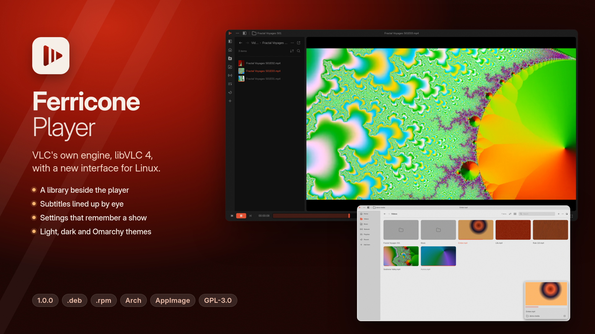

<p align="center">
  
</p>

<h1 align="center">Ferricone Player</h1>

<p align="center">
  A media player for Linux on VLC's own engine, libVLC 4, with a new interface in Rust and Slint.<br>
  <a href="https://nobledoodle.github.io/ferricone/">Website</a> ·
  <a href="https://github.com/NobleDoodle/ferricone/releases/latest">Download</a> ·
  <a href="#build-from-source">Build</a>
</p>



Ferricone plays everything VLC plays: the formats, hardware decoding, network
streams and subtitles all come from libVLC 4, bundled in every package. The
interface is new and follows Juxtopposed's "VLC Redesign": a library beside the
player, settings that remember a show, and a subtitle timeline.

## Features

- **Player.** A title bar and control bar that hide while you watch, seek
  thumbnails, an audio waveform in the seek bar, a volume wedge, chapters,
  bookmarks, and resume where you left off (asked, always or never).
- **Queue.** Play the rest of the folder, M3U8 playlists, and what happens when
  something ends (offer the next one, play it, stop or quit).
- **Library.** Videos, Music (Songs, Albums, Artists, Genres), Network streams,
  Playlists and Recent, in a dock beside the player or full window, with a grid
  or a list, sorting, search, watched progress and a miniplayer.
- **Sidebar.** Video, audio and subtitle settings with live filters, an
  equalizer, and presets saved per folder: fix a subtitle delay once and it
  sticks for the whole show.
- **Subtitles.** A timeline to line them up by eye, files matched to episodes by
  name, and search and download from OpenSubtitles with your own API key.
- **Cast** to Chromecast and UPnP devices on your network.
- **Settings** with search and a Keyboard Shortcuts editor.
- **Looks.** Light, dark or system themes, nine accents or any color, and the
  Omarchy theme's colors when Omarchy is installed.
- **Desktop.** Media keys and MPRIS, portal file dialogs, and Wayland or X11.

## Install

Every package holds the same build: Ferricone and libVLC 4 with the libraries a
desktop doesn't already have. It runs on any x86-64 distribution from 2022 on
(glibc 2.35 or newer). Download from the
[latest release](https://github.com/NobleDoodle/ferricone/releases/latest).

| System | Package | Size |
|---|---|---|
| Debian, Ubuntu, Mint, Pop!_OS | `ferricone_1.0.0_amd64.deb` | 58 MB |
| Fedora, openSUSE, RHEL 10 and its rebuilds | `ferricone-1.0.0-1.x86_64.rpm` | 63 MB |
| Arch, Manjaro, EndeavourOS | `ferricone-1.0.0-1-x86_64.pkg.tar.zst` | 75 MB |
| Any distribution | `Ferricone_Player-1.0.0-x86_64.AppImage` | 73 MB |
| Any distribution, no root | `ferricone-1.0.0-x86_64.tar.gz` | 79 MB |

**Debian, Ubuntu, Mint**

```sh
sudo apt install ./ferricone_1.0.0_amd64.deb
```

**Fedora, RHEL 10** (`sudo zypper install` on openSUSE)

```sh
sudo dnf install ./ferricone-1.0.0-1.x86_64.rpm
```

**Arch, Manjaro**

```sh
sudo pacman -U ferricone-1.0.0-1-x86_64.pkg.tar.zst
```

**AppImage**

```sh
chmod +x Ferricone_Player-1.0.0-x86_64.AppImage
./Ferricone_Player-1.0.0-x86_64.AppImage
```

It needs FUSE 2 (`libfuse2`); without it, run it with `--appimage-extract-and-run`.

**Archive**, installed into `~/.local` for your user only:

```sh
tar xzf ferricone-1.0.0-x86_64.tar.gz
ferricone-1.0.0-x86_64/install.sh      # uninstall.sh removes it again
```

**ChromeOS:** turn on the Linux development environment (Settings › About
ChromeOS › Developers), then open the `.deb` from Files and choose Install with
Linux.

The packages install to `/opt/ferricone` with a `ferricone` command, a menu
entry and an icon. Ferricone keeps its settings in `~/.config/ferricone`, what
you've watched in `~/.local/state/ferricone`, and playlists, streams and
downloaded subtitles in `~/.local/share/ferricone`; removing the package leaves
them.

## Build from source

### The packages

Each package has its own script, run from a clean checkout. They need only
Podman or Docker: everything else is built in containers (Ubuntu 22.04, and Arch
for the Arch package).

```sh
packaging/build-deb.sh         # dist/ferricone_1.0.0_amd64.deb
packaging/build-rpm.sh         # dist/ferricone-1.0.0-1.x86_64.rpm
packaging/build-pacman.sh      # dist/ferricone-1.0.0-1-x86_64.pkg.tar.zst
packaging/build-appimage.sh    # dist/Ferricone_Player-1.0.0-x86_64.AppImage
packaging/build-tarball.sh     # dist/ferricone-1.0.0-x86_64.tar.gz
packaging/build.sh all         # all five
```

The first build makes the container image (`packaging/Dockerfile`) and the
bundle every package wraps (`packaging/bundle.sh`: libVLC 4 with `patches/`,
Ferricone, and their libraries in `lib/deps`), which takes a while; later
builds reuse both. Pass `--rebuild` to start over. Downloads and build files
stay in `.package-cache/`.

`packaging/test.sh` then installs each package in fresh containers (Debian 12,
Ubuntu 22.04 and 24.04, Fedora, AlmaLinux 10, openSUSE Tumbleweed, Arch) and
checks that it starts, that no library is missing, and that no bundled
library breaks a system one loaded beside it.

### For development

```sh
./scripts/build-libvlc.sh          # pinned libVLC 4 into vendor/vlc, no system install
cargo run --release -- video.mkv
cargo test
```

`build-libvlc.sh` needs meson (1.10 or newer), ninja and VLC's build
dependencies; modules whose libraries are missing are skipped. It applies
`patches/` to VLC's sources. Development probes (`FERRICONE_STATS`,
`FERRICONE_VLC_ARGS`, `FERRICONE_OPEN_PANEL`) are described in `src/diag.rs`.

## libVLC patches

All are written for upstream.

| Patch | Why |
|---|---|
| `0001-libvlc-live-filter-api` | Public `libvlc_media_player_set_filter()` and `…_set_filter_option()`, so effects apply while playing. Per-media options never reach libVLC 4's player-owned outputs. The equalizer no longer replaces the other audio filters |
| `0002-vout-restore-display-format` | Removing a filter that changed the display chroma (e.g. sepia on VA-API) left the display on the old chroma, freezing the picture |
| `0003-access-output-file-skip-empty-blocks` | Writing a zero-length block counted as a failed write, flooding the log with "cannot write" while the waveform's audio is transcoded |
| `0004-freetype-live-font-and-outline-color` | The text renderer read the font and outline color only when it started, so the sidebar's subtitle font and outline color changed nothing during playback |
| `0005-freetype-live-opacity` | The same for the text and outline opacity, which the color picker's opacity slider sets |

## Layout

| Path | Role |
|---|---|
| `src/vlc.rs` | The only code that calls libVLC |
| `src/video.rs`, `src/video/egl.rs` | Hands frames from VLC's GL thread to Slint through a shared EGL context |
| `src/controls.rs`, `src/queue.rs` | Playback, resume and the queue |
| `src/library.rs`, `src/music.rs`, `src/thumbs.rs` | The library, the music index and cached thumbnails |
| `src/prefs.rs`, `src/preferences.rs`, `src/shortcuts.rs` | Settings (`app.toml`) and their window |
| `src/addsubs.rs`, `src/opensubtitles.rs` | Subtitle matching and OpenSubtitles |
| `src/theme.rs`, `ui/theme.slint` | Themes, accents and Omarchy colors |
| `ui/` | The Slint interface |
| `libvlc-sys/` | Raw FFI, generated by `scripts/gen-libvlc-bindings.sh` |
| `packaging/` | The Linux packages |
| `docs/` | The website (GitHub Pages, Jekyll) |

## Credits

The interface design and its icons (`ui/icons/`) are based on "VLC Redesign"
by Juxtopposed (Figma Community), licensed
[CC BY 4.0](https://creativecommons.org/licenses/by/4.0/). Changes: themes and
accents, Omarchy colors, window buttons per system, icons exported as SVG, and
the screens the design didn't have.

VLC and libVLC are by VideoLAN and its contributors, under the LGPL 2.1 or
later. "VLC" and the cone are VideoLAN trademarks; Ferricone is not made or
endorsed by VideoLAN.

## License

Ferricone is free software under the
[GNU General Public License, version 3 or later](LICENSE).
